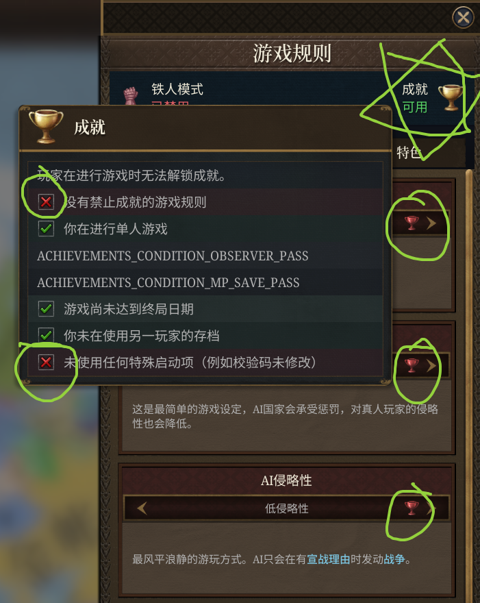

<div align="center">

# 🏆 EU5 Patcher

### 无条件开启成就

[中文](README_CN.md) | [English](README.md)

[](LICENSE)
[]()
[]()

</div>

---

## 📖 简介

关于是否应该强制要求使用**未修改的铁人模式**才能解锁成就的争论已经持续多年。虽然《十字军之王 III》和《群星》等游戏已经采取了对玩家更加友好的方式，但《欧陆风云 V》遗憾地在这一点上倒退了一步。

这个补丁可以让你：

* 在非铁人模式下开启**所有成就**。
* 在非铁人模式下启用**所有游戏规则**。

| 模式       | Mod    | 设置   | 控制台 | 存档 & 读档 | 成就   |
| ---------- | ------ | ------ | ------ | ----------- | ------ |
| 非铁人模式 | ✅ 任意 | ✅ 任意 | ✅ 开启 | ✅ 开启      | ✅ 开启 |

<div align="center">

</div>

---

## 🚀 如何使用

> [!TIP]
> 每次游戏更新后，都需要重新对 `eu5.exe` 打补丁。

### 🐍 方法 1：Python 脚本

你可以在任意位置运行该脚本。

```bash
python patch.py
```

### ⚙️ 方法 2：从源码编译（C++）

```bash
# 1. 编译源代码
cl /std:c++17 /O2 /EHsc patch.cpp

# 2. 运行生成的 patch.exe
patch.exe
```

### ⚠️ 方法 3：预编译可执行文件

> [!WARNING]
> 运行未知来源的可执行文件存在风险。请仅在你信任该来源的情况下继续。

1. 从 [📦 Releases 页面](https://github.com/UFOdestiny/EU5-Patcher/releases/) 下载 `patch.exe`。
2. 运行 `patch.exe`。

---

## ✅ 打补丁后

如果补丁应用成功，你将看到类似以下信息：

```text
Path: "E:\\\\SteamLibrary\\steamapps\\common\\Europa Universalis V\\binaries\\eu5.exe"
Backup created: "E:\\\\SteamLibrary\\steamapps\\common\\Europa Universalis V\\binaries\\eu5.exe.backup"

Patch #1 (CanGetAchievements Branch-1) found at offset: 0x1a1360 (RVA 0x1a1f60)

Patch #2/#3 (registered manager eligibility) found at offset: 0x3086230 (RVA 0x3086e30)

Patch #4 (IsGameRuleEnabled predicate) found at offset: 0x4d72f20 (RVA 0x4d73b20)

Patch #5 (Native achievement update gate) found at offset: 0x604ba1f (RVA 0x604c61f)

Patch #6 (Native eligibility boolean gate) found at offset: 0x604becd (RVA 0x604cacd)

Patch #7 (Native eligibility boolean gate) found at offset: 0x9c10e96 (RVA 0x9c11a96)

Patch #8 (Native eligibility boolean gate) found at offset: 0x9c11d43 (RVA 0x9c12943)

EU5 is successfully patched.
Press Enter to exit...
```

---

## 📚 工作原理

```text
"CanGetAchievements"
    -> Registration #1 -> callback -> predicate -> Patch #1
    -> Registration #2 -> callback -> predicate -> Patch #2
                                     |
                                     +-> manager eligibility -> Patch #3
                                         (can be the predicate itself)

"IsGameRuleEnabled"
    -> registration -> callback -> boolean callee -> Patch #4
                       (preserve output marshalling)

Native eligibility predicate / update / list initialization / list refresh
    -> validated allowed branches -> Patches #5-#8

B8 01 00 00 00 C3     mov eax, 1; ret  (#1-#4)
75 -> EB             take existing true branch (#6-#8)
0F 84 ... -> NOPs    enter normal update evaluation (#5)
```

新版的 GUI 注册分支与管理器资格函数副本共用入口，合并为一次写入；还需覆盖共享原生函数和 3 处内联检查。原来的“checksum”名称实际指六字段成就资格检查。游戏规则回调的输出封装和具体成就的 `possible`/`happened` 条件仍会正常执行。先验证全部目标，再备份并只写入对应字节；定位不完整时拒绝写入。

---

## 🧪 回归验证

```powershell
# 合成 PE 的新旧注册结构测试
python -m unittest discover -s tests -v

# 同时验证 C++ 与真实游戏文件（只操作临时副本）
$env:EU5_CPP_PATCHER = (Resolve-Path .\patch.exe).Path
$env:EU5_TEST_EXE = 'E:\SteamLibrary\steamapps\common\Europa Universalis V\binaries\eu5.exe.backup'
python -m unittest discover -s tests -v
```

---

## 🙌 致谢

本项目主要用于学习和教育目的。灵感来源于：

* [Enabling Achievements in Stellaris With Mods (All game versions) [SRE]](https://steamcommunity.com/sharedfiles/filedetails/?id=2460079052)
